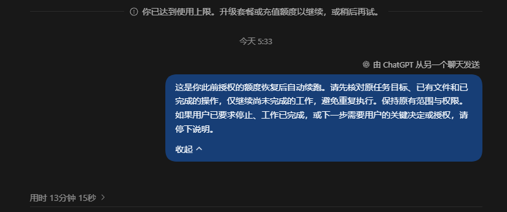

# Codex 额度恢复续跑助手

> **自用项目**：仅供本人在自己的 Windows 和 Codex 环境中使用，不保证其他设备或后续版本兼容。

用于 Windows Codex 桌面应用的本地小工具。额度恢复后，快速恢复被中断的任务。

## 用法

**额度耗尽、任务中断 → 打开助手 → 等待额度恢复 → 自动继续。无需提前开启。**

1. 额度用完后，双击桌面 **Codex 续跑助手** 快捷方式，或本目录的 **Start-AutoResume.cmd**。保持 Codex 桌面应用运行并登录。
2. 选择刚刚中断的本机 Codex 聊天，点击 **开启监控**，授权助手在额度恢复后继续这个任务。
3. 助手读取已经发生的额度中断，每 60 秒检查一次；无需再手动输入“继续”。
4. 服务端确认额度恢复后，助手自动向原聊天发送一次继续指令。

点击 **停止监控** 或关闭助手窗口即可取消监控；这不会中断已经开始的 Codex 任务。再次打开助手必须重新选择聊天并开启。需要电脑保持唤醒、Codex 和助手窗口保持运行；睡眠期间不能检查。

**他人下载后不能直接使用，需具备下方运行环境并完成本机配置。**

从 GitHub 重新克隆时，需要先将 `local_settings.example.json` 复制为 `local_settings.json`，填入一个用于管理助手的本机 Codex 聊天 UUID。这个管理聊天用于应用接口的调用上下文，和下拉框中选择的待监控聊天是两个独立的角色。在管理聊天输入 `/status` 可以查看其聊天 ID。作者当前这台电脑已配置；真实聊天 ID、运行状态和缓存均通过 `.gitignore` 排除，不上传 GitHub。

**模拟验证** 按钮只运行本地测试，不会向任何真实聊天发送消息。

## 使用示例

额度恢复后，助手在原聊天中发送继续指令：

## 本机要求

当前机器已验证 Python 3 和 Tkinter 可用，启动脚本优先使用现有的 `%USERPROFILE%\miniforge3\pythonw.exe`，其次使用 PATH 中的 `pythonw.exe`。无需安装第三方 Python 包，也不需要填写 API key。

连接仅通过 Codex 自带的本地应用工具管道；不读取或复制登录令牌，不修改 Codex 安装目录、配置文件或聊天数据库。多个 Codex 应用连接同时存在且无法唯一定位时，工具会拒绝连接。

本目录包含仅保存在本机的 `local_settings.json`（管理聊天编号），运行后可能产生 `state.json`（目标聊天编号、账号编号、等待状态及去重记录）、`app.lock`（防止重复打开）和 Python 缓存。聊天正文和额度查询结果不会写入磁盘日志。删除本目录即可移除工具；删除 `state.json` 会丢失去重记录，应仅在监控停止并核实原聊天后操作。

## 验证与文件

- `app.py`：选择聊天、启停监控和状态窗口。
- `core.py`：触发条件、恢复判断和持久化去重。
- `bridge.py`：与当前 Codex 桌面应用的本地接口通信，只有四个必要工具在允许列表中。
- `test_monitor.py`：22 项回归测试，不连接真实聊天，包含真实错误结构回放及“先中断、后开启监控”的完整流程。
- `VERIFICATION.md`：本次验证记录。

只读连接检查：`python app.py --check`。本地测试：`python test_monitor.py`。

官方参考：[Codex App Server](https://learn.chatgpt.com/docs/app-server)、[Codex queue](https://learn.chatgpt.com/docs/cli/reference#codex-queue)。
